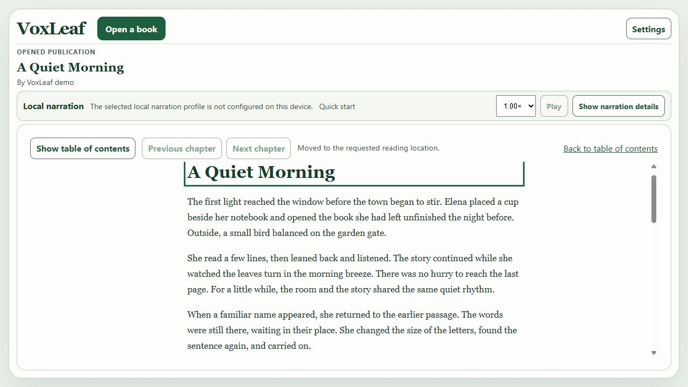

# VoxLeaf

Read and listen to your EPUBs with AI speech generated on your own computer.
VoxLeaf combines a reflowable reader, bilingual local narration and bounded
in-memory audio in a Windows desktop application.

[**Watch the demo**](https://www.youtube.com/watch?v=2CU36tmh7Fc) ·
[**Try the reader**](docs/portfolio/try-voxleaf.md) ·
[**Engineering case study**](docs/portfolio/case-study.md)

[](https://www.youtube.com/watch?v=2CU36tmh7Fc)

*Actual browser development reader with original sample text. Native narration
is unavailable in this view; the linked video demonstrates the desktop product.*

> **Status:** pre-alpha portfolio MVP for Windows x64. Piper Spanish and English
> voices are bundled in the desktop package; Chatterbox is optional on compatible
> hardware. The installer is unsigned and available only for controlled local
> evaluation. There is no trusted public application download yet.

## What works today

- **Read and resume:** open a supported local EPUB, navigate its contents,
  customize its appearance and restore a logical position after reselecting
  the same book bytes.
- **Listen locally:** use Piper on CPU or optionally acquire Chatterbox on a
  compatible NVIDIA GPU. Select English or Spanish, Quick or Prepared start,
  and playback rates from `1.00x` down to `0.75x`.
- **Keep text and audio together:** follow the audible passage, navigate and
  invalidate obsolete work when the reading session changes.

EPUB contents and inference stay on the device. Generated audio is held in
bounded memory and is not saved by default. Model acquisition is an explicit
download; it does not upload book contents.

## Demo video

The [existing walkthrough](https://www.youtube.com/watch?v=2CU36tmh7Fc) shows
reading, navigation and bilingual Piper/Chatterbox narration. It remains the
presentation video for this MVP. See the [evaluation walkthrough](docs/portfolio/try-voxleaf.md)
for a reproducible original sample and the distinction between browser and
desktop capabilities.

## Architecture

| Layer | Responsibility | Technology |
| --- | --- | --- |
| Reader | Safe document rendering, settings and synchronized passage display | React, TypeScript |
| EPUB engine | Validation, semantic projection, stable locators and narration preparation | TypeScript |
| Desktop host | Process ownership, cancellation, hardware admission and package integrity | Rust, Tauri |
| Speech service | Local model loading and bounded synthesis | Python, Piper, optional Chatterbox |
| Audio | In-memory buffering, playback and heard-position observations | Web Audio |

[Compact system diagram](docs/architecture/system-diagram-compact.md) ·
[Canonical architecture](docs/architecture/system-diagram.md)

## Development and authorship

This portfolio explores **local AI in a full-stack desktop application** and
**agentic software development**. The maintainer originated the idea, selected
some tools and chose agentic workflows. Coding agents carried out development.
The [case study](docs/portfolio/case-study.md) explains that division of work,
engineering tradeoffs and the repository's independent review and host-validation
process. It does not present agent implementation as manually authored code.

For a local visual-reader evaluation, complete the pinned Node/pnpm setup and run:

```powershell
pnpm.cmd install --frozen-lockfile
pnpm.cmd build:packages
pnpm.cmd demo:sample
pnpm.cmd --filter @voxleaf/desktop dev
```

Open `http://127.0.0.1:5173` and select `tmp/portfolio/voxleaf-sample.epub`.
This browser route provides reading and navigation, **not native narration**.
Full desktop prerequisites and checks are in [development setup](docs/development/setup.md).

## Current limits

- Windows x64 is the packaged platform; public distribution awaits signing and
  release approval. GitHub's `chatterbox-runtime-*` releases are component assets,
  not the VoxLeaf application installer.
- Supported input is bounded reflowable EPUB 3 or the admitted EPUB 2/NCX
  profile. DRM, fixed layout, scripts and remote content are outside the MVP.
- Chatterbox requires compatible hardware, a substantial download and potentially
  more than a minute for initial loading. Piper provides the CPU path.
- Qwen is development-only. Automatic updates and automatic engine failover
  are not implemented.

[Hardware and runtime support](docs/architecture/tts-support-matrix-v2.md) ·
[Windows installation and release limits](docs/user/windows-release.md) ·
[Current requirements](docs/product/mvp.md#target-acceptance-criteria)

## Explore the work

- [Engineering case study and evidence](docs/portfolio/case-study.md)
- [Documentation index](docs/README.md) and [roadmap](docs/plans/roadmap.md)
- [Testing strategy](docs/development/testing.md) and [CI](https://github.com/mmjosedaniel/voxleaf/actions)
- [Contributing](CONTRIBUTING.md) and [security policy](SECURITY.md)

## License

[MIT](LICENSE). Bundled and optional TTS components retain their own licenses,
notices and source-fulfillment obligations in the release inventory. Sample text
is original repository-authored demo content generated through the agentic workflow.
